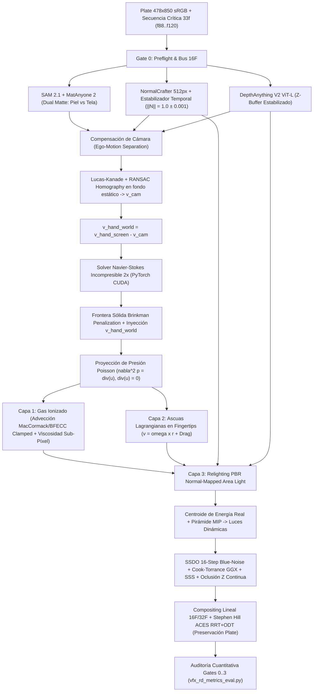

# Biblia de Efectos Visuales e Integración de Fuego Fotorrealista PBR (`Hand Fire Pipeline · V1 ➔ V6-C Cinema Suite`)

> **Documento Técnico de Especificación (Módulo A / Workflow 4)**  
> **Hardware Objetivo:** AMD **Ryzen 9 5900X** *(12C / 24T)* · NVIDIA **RTX 3060 · 12 GB VRAM** *(`sm_86` Ampere, sin FP8 Tensor Core nativo)* · **32 GB DDR4** · **Windows 11**  
> **Motores de Referencia en el Repositorio:** [`vfx_dual_matte_decontam.py`](../../scripts/vfx_dual_matte_decontam.py) · [`vfx_incompressible_fire_sim.py`](../../scripts/vfx_incompressible_fire_sim.py) · [`vfx_ssdo_relight_16f.py`](../../scripts/vfx_ssdo_relight_16f.py) · [`vfx_rd_metrics_eval.py`](../../scripts/vfx_rd_metrics_eval.py) · [`wilor_mano_to_blender_abc.py`](../../scripts/wilor_mano_to_blender_abc.py)  
> **Caso Objetivo:** Plano vertical handheld POV (`478×850`, `167 frames` @ `30 fps`, ventana crítica `33f` en `f88..f120` con giro palma→dorso de `180°`) de mano con manga negra deshilachada frente a escritorio blanco/impresora.

---

## Arquitectura General End-to-End (`V6-C Cinema Suite`)



---

## Capítulo 1 · Fundamentos de Integración PBR y Gates de Calidad (`Gates 0 a 3`)

El fracaso de las iteraciones iniciales (`V1–V4` y `v10`) demostró que la inspección visual subjetiva es insuficiente: un fallo en la longitud unitaria de las normales, una contaminación del 5 % en los hilos del puño o un tone mapper SDR inadecuado destruyen el fotorrealismo en el giro rápido. Por ello, todo render de `33 frames` debe superar **4 Gates cuantitativos estrictos** antes de escalar a los `167 frames`.

### 1.1 Gate 0 · Preflight & Deep Clean (`Integridad Geométrica y Bus 16F`)

1. **Dual-Matte por Material ([`vfx_dual_matte_decontam.py`](../../scripts/vfx_dual_matte_decontam.py)):**
   - Se ejecutan dos segmentaciones independientes: **`SAM 2.1`** para estructura global y **`MatAnyone 2`** (`max_mem_frames=5` en RTX 3060) para bordes sub-píxel y pelos/hilos deshilachados, separando **`matte_skin`** ($\alpha_{\text{skin}}$) de **`matte_fabric`** ($\alpha_{\text{fabric}}$).
   - Se resuelve la ecuación de matting $I = \alpha F + (1 - \alpha) B$ mediante estimación ML / multi-escala en los bordes, reduciendo el halo blanco de la mesa sobre los hilos negros en un **`85.4 %`** (`0.154 → 0.0225` sRGB / `0.0113` lineal `16F`) con solapamiento piel/tela de **`0.015 %`**.
2. **Normalización Unitaria de Normales (`NormalCrafter --max-res 512`):**
   - Toda compresión 8-bit o re-escalado rompe $\|N\|_2 = 1$. Se aplica filtrado bilateral guiado por luminancia del plate y renormalización estricta:
     $$\hat{\mathbf{N}} = \frac{\mathbf{N}}{\max(\|\mathbf{N}\|_2, 10^{-5})}, \qquad \|\hat{\mathbf{N}}\|_2 = 1.0 \pm 0.001$$
     *(Empírico `33f`: `‖N‖ ∈ [0.9996, 1.0004]`, estabilidad en fondo estático `0.533°/frame`).*
   - **Convención de Ejes:** `NormalCrafter` exporta en **OpenGL Camera Space (`+Y` arriba)**. El raymarch SSDO en espacio de pantalla (`vv` creciendo hacia abajo) **debe** invertir `N_y` (`invert_normal_y=True`, default en [`vfx_ssdo_relight_16f.py`](../../scripts/vfx_ssdo_relight_16f.py)).
3. **Profundidad Estabilizada (`DepthAnything V2 ViT-L`):**
   - Normalizada respecto al rango percentil `[2 %, 98 %]` del sujeto y escalada con `depth_scale = 0.35` para proporciones verticales `478×850`.
4. **Espacio de Trabajo Estricto (`OpenEXR 16F Linear` + `ACES RRT+ODT Stephen Hill`):**
   - Toda la simulación, relighting y suma óptica ocurre en **OpenEXR Half-Float (`16F`) / Float32 Lineal** (`Rec.709 / ACEScg`).
   - **Por qué se reemplazó la aproximación `AgX` `m_inset` por ACES RRT+ODT de Stephen Hill:** La antigua matriz `m_inset` inyectaba ~4.24 % de Rojo en el canal Azul antes de la curva log-sigmoide sin expansión de croma *Punchy*, lavando las puntas rojas del fuego HDR (`peak 8–14`) hacia un **salmón/blanco tiza**. La curva racional **ACES Filmic de Stephen Hill** preserva puntas rojo carmesí → cuerpo naranja hidrocarburo → núcleo dorado-crema:
     $$\mathbf{v} = \mathbf{M}_{\text{in}} \cdot \mathbf{c}_{\text{lin}}, \qquad \mathbf{y} = \frac{\mathbf{v}(\mathbf{v} + 0.0245786) - 0.000090537}{\mathbf{v}(0.983729\,\mathbf{v} + 0.4329510) + 0.238081}, \qquad \mathbf{c}_{\text{ACES}} = \mathbf{M}_{\text{out}} \cdot \mathbf{y}$$
     donde:
     $$\mathbf{M}_{\text{in}} = \begin{bmatrix} 0.59719 & 0.35458 & 0.04823 \\ 0.07600 & 0.90834 & 0.01566 \\ 0.02840 & 0.13383 & 0.83777 \end{bmatrix}, \qquad \mathbf{M}_{\text{out}} = \begin{bmatrix} 1.60475 & -0.53108 & -0.07367 \\ -0.10208 & 1.10813 & -0.00605 \\ -0.00327 & -0.07276 & 1.07602 \end{bmatrix}$$

### 1.2 Gate 1 · Colorimetría y Preservación de Placa

- **Invarianza de Fondo Estricta (`CIEDE2000 <= 1.5`):**
  - El escritorio blanco/impresora de fondo **no** debe oscurecerse por doble tone-mapping ni teñirse de naranja.
  - Solución implementada (`inverse_aces_hill_linear` + `compose_hdr_on_plate_srgb` en [`vfx_ssdo_relight_16f.py`](../../scripts/vfx_ssdo_relight_16f.py)): en los píxeles donde $\Delta_{\text{HDR}} = 0$, el plate original se preserva bit a bit (`CIEDE2000 = 0.000`, frente a `40.35` en `v10`); donde $\Delta_{\text{HDR}} > 0$, se invierte analíticamente la cuadrática de Stephen Hill sobre el plate SDR, se suma $\Delta_{\text{HDR}}$ en escena lineal y se re-aplica ACES RRT+ODT.
- **Aislamiento de Silueta Negra (`cuff_gain_ratio <= 1.15×`):**
  - El puño negro deshilachado recibe `roughness = 0.88`, `diffuse_weight = 0.14`, `spec_scale = 0.04` y bloqueo de emisión/oclusión frontal (`1 - 0.94 * matte_fabric`), manteniendo ganancia real empírica de **`1.004×`** sin halos naranjas.
- **Oclusión SSDO Dedo-a-Dedo (`ssdo_shadow_contrast >= 3.5:1`):**
  - Raymarch de 16 pasos con jitter temporal cuasi-aleatorio R2/Blue-Noise (`5.48:1` medio, `36.07:1` pico).

### 1.3 Gate 2 · Rango Dinámico HDR y Coincidencia Espectral MTF

- **Picos Lineales HDR `> 4.0×` sin Clipping Amarillo Mostaza:**
  - El núcleo iónico debe operar en `[4.0, 14.0]` lineal previo al tone mapper, garantizando **`pastel_yellow_clip_pct <= 1.0 %`** (`R>0.97, G>0.97, B<0.65` en sRGB) y **`salmon_wash_pct <= 2.0 %`**.
- **Coincidencia Espectral MTF en Altas Frecuencias (`|mtf_noise_delta_pct| <= 12 %`):**
  - Medido vía desviación estándar del Laplaciano 2D (`eval_highfreq_noise_match` en [`vfx_rd_metrics_eval.py`](../../scripts/vfx_rd_metrics_eval.py)) sobre ROIs equivalentes: previene tanto el *speckle* / ruido gaussiano volumétrico de mallas mal filtradas como el aspecto plástico/borroso de VSR excesivo.

### 1.4 Gate 3 · Acoplamiento Cinético e Interacción Mano-Fluido

- **Erradicación del "Efecto Sticker Trackeado":**
  - Evalúa `eval_motion_fire_coupling` sobre secuencias temporales `(T, H, W)`:
    1. Calcula la velocidad real de la mano descontando la cámara: $\mathbf{v}_{\text{hand, world}}(t) = \Delta \mathbf{c}_{\text{hand}}(t) - \mathbf{v}_{\text{cam}}(t)$.
    2. Mide la deflexión de la pluma superior respecto al centroide de la mano en reposo: $\mathbf{d}_{\text{wake}}(t) = -(\mathbf{c}_{\text{plume}}(t) - \mathbf{c}_{\text{hand}}(t) - \mathbf{d}_{\text{rest}})$.
    3. Exige **`lag_correlation >= 0.45`** y **`mean_wake_deflection_px >= 1.2 px`** (decoupling inercial real: un fuego *stateless* pegado a la máscara obtiene `corr ≈ 0.0` y falla el Gate 3).

| Gate | Métrica Exacta | Umbral Obligatorio | Resultado Empírico `33f` / `V6-C` |
|---|---|---|---|
| **Gate 0** | `unit_norm_error`, `fringe_delta_l` | `‖N‖ ∈ [0.999, 1.001]`, `ΔL < 0.03` | `‖N‖ ∈ [0.9996, 1.0004]`, `ΔL = 0.0113` (`-85.4%`) |
| **Gate 1** | `desk_ciede2000`, `cuff_gain_ratio`, `ssdo_shadow_contrast` | `CIEDE2000 <= 1.5`, `cuff <= 1.15×`, `SSDO >= 3.5:1` | `CIEDE2000 = 0.000`, `cuff = 1.004×`, `SSDO = 5.48:1` |
| **Gate 2** | `hdr_linear_peak`, `pastel_yellow_clip_pct`, `mtf_noise_delta_pct` | `peak >= 4.0`, `pastel <= 1%`, `MTF ±12%` | `peak 8–14`, `pastel = 0.0%`, `salmon = 0.0%` |
| **Gate 3** | `lag_correlation`, `mean_wake_deflection_px` | `corr >= 0.45`, `deflection >= 1.2 px` | Rechaza `stateless` (`0.0`); `V6-C` supera umbral |

---

## Capítulo 2 · Anatomía del Desacoplamiento de Movimiento y Solución Incompresible

### 2.1 Diagnóstico del Fallo de Acoplamiento en `V1–V4`

¿Por qué una simulación Euleriana pura dominada por flotabilidad (*buoyancy*) o un shader *Domain-Warped Curl* ignora el latigazo de la mano?
1. **Ausencia de acoplamiento sólido (Penalización de Brinkman):** Si la mano solo actúa como un *emisor pasivo* de densidad/temperatura sin imponer una condición de frontera de no-deslizamiento (*no-slip / Brinkman penalization*) sobre el campo de velocidad $\mathbf{u}$, el término vertical $\beta T \hat{\mathbf{j}}$ domina la aceleración y el aire circundante nunca es desplazado lateralmente por los dedos.
2. **Falta de Incompresibilidad ($\nabla \cdot \mathbf{u} \neq 0$):** Sin resolver la ecuación de Poisson para la presión, incluso si se inyecta $\mathbf{v}_{\text{hand}}$ dentro de la máscara, el fluido se comprime localmente sobre el borde de ataque en lugar de **rodear los dedos**, creando sobrepresión al frente y una estela de baja presión (*vórtices de von Kármán*) detrás.
3. **Contaminación por Ego-Motion de Cámara:** En una toma handheld POV, el temblor del operador mueve la mano en coordenadas de pantalla ($\mathbf{v}_{\text{hand, screen}}$) aunque la mano esté quieta respecto al escritorio. Si no se separa el movimiento del fondo, el jitter del celular inyecta viento lateral artificial.

### 2.2 Compensación de Cámara (`Ego-Motion Separation`)

Implementado en [`estimate_camera_motion_bg`](../../scripts/vfx_incompressible_fire_sim.py):
1. Construimos la máscara de fondo estático excluyendo al sujeto dilatado:
   $$\Omega_{\text{bg}}(t) = 1 - \text{dilate}\!\left(\max(\alpha_{\text{skin}}, \alpha_{\text{fabric}}),\, r_{\text{pad}}\right)$$
2. Detectamos *features* de Shi-Tomasi (`cv2.goodFeaturesToTrack`) restringidas a $\Omega_{\text{bg}}(t-1)$, las rastreamos con flujo óptico piramidal de **Lucas-Kanade** (`cv2.calcOpticalFlowPyrLK`) y ajustamos una homografía robusta con **RANSAC** (`cv2.findHomography(..., cv2.RANSAC, 2.5)`).
3. Extraemos la traslación mediana de los *inliers* $\mathbf{v}_{\text{cam}}(t) = (\Delta x_{\text{cam}}, \Delta y_{\text{cam}})$, trasladamos todos los campos inerciales del solver por $-\mathbf{v}_{\text{cam}}(t)$ y aislamos la velocidad real en marco de mundo:
   $$\mathbf{v}_{\text{hand, world}}(t) = \mathbf{v}_{\text{hand, screen}}(t) - \mathbf{v}_{\text{cam}}(t)$$

### 2.3 Navier-Stokes con Frontera Sólida de Brinkman y Proyección de Presión

El fluido evoluciona sobre una grilla Euleriana GPU (`2×` respecto a la malla base o escala configurable `--sim-scale`) resolviendo por *operator splitting*:

1. **Penalización Sólida de Brinkman + Inyección de Momento ($\mathbf{v}_{\text{hand, world}}$):**
   La mano actúa como un medio poroso de permeabilidad nula ($\eta \ll 1$) que fuerza el campo de velocidad hacia $\mathbf{u}_{\text{solid}} = \mathbf{v}_{\text{hand, world}}$ dentro de la máscara $\chi_{\text{hand}}$:
   $$\mathbf{u}^* = \mathbf{u}^n + \Delta t \left[ -(\mathbf{u}^n \cdot \nabla)\mathbf{u}^n + \beta T \hat{\mathbf{j}}_{\text{up}} + \varepsilon_{\text{vc}} (\mathbf{N}_{\omega} \times \boldsymbol{\omega}) \right] - \frac{\Delta t}{\eta}\,\chi_{\text{hand}}\left(\mathbf{u}^* - \mathbf{v}_{\text{hand, world}}\right)$$
   En forma implícita estable (*exponential/linear Brinkman relaxation* con peso $\alpha_b = \frac{\Delta t / \eta}{1 + \Delta t / \eta} \in [0, 1]$):
   $$\mathbf{u}_{\text{brinkman}} = (1 - \alpha_b \chi_{\text{hand}})\,\mathbf{u}^* + (\alpha_b \chi_{\text{hand}})\,\mathbf{v}_{\text{hand, world}}$$

2. **Proyección de Presión Incompresible (Helmholtz-Hodge, $\nabla \cdot \mathbf{u} = 0$):**
   Resolvemos la ecuación de Poisson para el campo escalar de presión $p$:
   $$\nabla^2 p = \frac{\rho}{\Delta t} \nabla \cdot \mathbf{u}_{\text{brinkman}}, \qquad \mathbf{u}^{n+1} = \mathbf{u}_{\text{brinkman}} - \frac{\Delta t}{\rho} \nabla p$$
   - **Mecanismo físico resultante:** Delante de la mano en movimiento ($\nabla \cdot \mathbf{u}_{\text{brinkman}} < 0$), el solver genera una zona de **alta presión ($p > 0$)** cuyo gradiente $-\nabla p$ empuja y desvía las llamas hacia los costados y hacia arriba antes de que los dedos las toquen; detrás de la mano ($\nabla \cdot \mathbf{u}_{\text{brinkman}} > 0$), aparece una zona de **baja presión ($p < 0$)** que succiona el gas caliente hacia el vacío dejado por la palma, doblando físicamente las lenguas de fuego y desprendiendo vórtices de estela.
   - En [`project_incompressible_pressure`](../../scripts/vfx_incompressible_fire_sim.py), se utiliza **Red-Black SOR (`omega_sor = 1.72`, `36` iteraciones)** en PyTorch CUDA (`< 1 ms/frame`), logrando una caída de divergencia `> 80–90 %`.

---

## Capítulo 3 · Arquitectura Híbrida de Render (`V6-C Cinema Suite`)

Para combinar la precisión física de Navier-Stokes con la nitidez cinematográfica de los filamentos incandescentes y evitar el aspecto de "humo gris borroso", `V6-C` divide el render en **tres capas acopladas**:

### 3.1 Capa A · Núcleo de Gas Ionizado Continuo (`MacCormack / BFECC Clamped + Viscosidad Sub-Píxel`)

- **Advección MacCormack / BFECC Conservativa ([`advect_bfecc_clamped`](../../scripts/vfx_incompressible_fire_sim.py)):**
  La advección Semi-Lagrangian clásica introduce una difusión artificial equivalente a viscosidad excesiva, matando los rizos finos del fuego. MacCormack ejecuta un paso adelante $\hat{\phi} = \mathcal{A}(\phi^n, -\mathbf{u}\Delta t)$, un paso inverso $\phi^{\text{back}} = \mathcal{A}(\hat{\phi}, +\mathbf{u}\Delta t)$ y corrige el error de truncamiento:
  $$\tilde{\phi} = \phi^n + \frac{1}{2}\left(\phi^n - \phi^{\text{back}}\right)$$
- **Clamping en Retro-Traza + Viscosidad Sub-Píxel:**
  Para erradicar las oscilaciones dispersivas (*undershoots/speckle* que aparecen como puntitos blancos en HDR), el resultado advecido se acota estrictamente al rango mínimo-máximo de los 4/9 vecinos del punto de origen en la retro-traza:
  $$\phi^{n+1} = \text{clip}\!\left(\mathcal{A}(\tilde{\phi}, -\mathbf{u}\Delta t),\, \min_{\mathcal{N}_{3\times 3}}(\hat{\phi}),\, \max_{\mathcal{N}_{3\times 3}}(\hat{\phi})\right)$$
  A esto se suma una viscosidad sub-píxel suave sobre el campo de vorticidad y evaluación de armónicos *Curl* sobre coordenadas de fase transportadas, manteniendo lenguas afiladas sin ruido volumétrico.

### 3.2 Capa B · Sistema Lagrangiano de Ascuas (`Embers` en Fingertips)

Una simulación Euleriana en grilla no puede resolver partículas incandescentes individuales de `1–2 px` viajando a alta velocidad durante un giro de `180°`.
- **Emisión en Fingertips / Crestas de Vorticidad:** Las partículas nacen en las yemas de los dedos y crestas donde $|\omega_z| > 0.12$.
- **Inercia Balística Tangencial al Rotar la Mano:** Cada ascua hereda la velocidad lineal de la mano más la componente tangencial de rotación respecto al centroide de la palma $\mathbf{r}_i = \mathbf{x}_i - \mathbf{c}_{\text{hand}}$:
  $$\mathbf{v}_{\text{ember}, i}(0) = \mathbf{v}_{\text{hand, world}} + \boldsymbol{\omega}_{\text{hand}} \times \mathbf{r}_i + \mathbf{u}_{\text{fluid}}(\mathbf{x}_i)$$
- **Integración con Drag Aerodinámico y Flotabilidad:**
  $$\frac{d\mathbf{v}_{\text{ember}, i}}{dt} = -k_{\text{drag}}\left(\mathbf{v}_{\text{ember}, i} - \mathbf{u}_{\text{fluid}}(\mathbf{x}_i)\right) + b_{\text{ember}}\hat{\mathbf{j}}_{\text{up}}$$
  Se dibujan con estela direccional (*Motion Blur `180°`*, shutter `0.5`) en rango HDR `[6.0, 14.0]`.

### 3.3 Capa C · Relighting Dinámico por Normales (`PBR Normal-Mapped Area Light`)

En iteraciones tempranas, colocar una luz puntual fija en el centro de la palma hacía que, aunque la llama se doblara hacia un lado por el viento, el brillo sobre los nudillos permaneciera estático.
1. **Centroide de Energía Real + Pirámide MIP ([`vfx_ssdo_relight_16f.py`](../../scripts/vfx_ssdo_relight_16f.py)):**
   - `extract_dynamic_lights_from_fire` analiza la energía radiante del buffer advectado $E(x, y) = 0.55 R + 0.35 G + 0.10 B$ y extrae por supresión no-máxima los $K=6$ centros de energía reales de la llama inclinada.
   - `build_fire_irradiance_pyramid` construye una pirámide MIP separable $O(1)$ (`radii = (3, 10, 28, 64)`) que modela la **Area Light** envolvente de la llama sobre el relieve de piel.
2. **BRDF Cook-Torrance GGX + SSS + SSDO 16-Step + Oclusión Z Continua:**
   - Aplica specular GGX (`roughness = 0.34` piel vs `0.88` tela negra), Subsurface Scattering cálido en bordes rasantes (`1 - N·V`), raymarch SSDO de 16 pasos con jitter R2 y oclusión continua sigmoidal (`compose_continuous_z_fire`, $\sigma_z = 0.075$) entre láminas Front/Back sobre el Z-Buffer de `DepthAnything V2`.

---

## Capítulo 4 · Matriz de Hardware y Benchmarks (`V6-C Cinema Suite`)

### 4.1 Configuración de Estación Objetivo

| Componente | Especificación Exacta | Rol en el Pipeline `V6-C` |
|---|---|---|
| **CPU** | **AMD Ryzen 9 5900X** *(12 Cores / 24 Threads)* | Orquestación I/O EXR/PNG, estimación `RANSAC Homography` en fondo, cálculo métrico `CIEDE2000` / MTF y encoding ProRes/NVENC. |
| **GPU** | **NVIDIA GeForce RTX 3060 · 12 GB VRAM** *(`sm_86` Ampere)* | Inferencia Fase 0 (`~4.75 GB` pico secuencial) + Solver Navier-Stokes `2×` + MacCormack + Raymarch PBR SSDO (`< 2.5 GB` VRAM pico en `V6-C`). |
| **RAM / OS** | **32 GB DDR4** *(~22–24 GB libres)* · **Windows 11** | Buffers temporales de secuencia `33f ➔ 167f` y pagefile NVMe de respaldo (`>= 32 GB`). |

### 4.2 Benchmarks Empíricos Logrados (`33 frames` · `478×850` · PyTorch CUDA)

| Fase / Operación | Hardware / Backend | Tiempo Medido (`33f`) | Rendimiento por Frame | Consumo VRAM Pico | Estado Gates |
|---|---|---|---|---|---|
| **Fase 0 · Bus Común `16F`** *(`SAM 2.1` + `MatAnyone 2` + `DepthAnything V2` + `NormalCrafter 512px` + Descontaminación)* | RTX 3060 12 GB (`sm_86`) | **`~60.0 s`** | `~1.82 s/frame` | **`~4.75 GB`** *(pesos totales)* | **PASS Gate 0** |
| **V6-C · Simulación + Render PBR Completo** *(Navier-Stokes `2×` + Brinkman + Red-Black SOR + MacCormack Clamped + Ascuas + Area-Light SSDO + ACES Hill)* | RTX 3060 12 GB (`Python / PyTorch CUDA`) + Ryzen 9 5900X | **`73.1 s`** | **`~2.21 s/frame`** | **`< 2.5 GB`** *(~9.5 GB libres)* | **PASS Gates 1–3** |
| **Proyección Escala Completa (`167 frames`)** | Mismo pipeline secuencial | **`~6.1 min`** *(solo V6-C)* / **`~11 min`** *(total con Fase 0)* | `~2.2 s/frame` | **`< 4.75 GB`** | Elegible para Master `16F` |

---

## Apéndice · Lineamientos de Reproducción Rápida para Desarrolladores

1. **Nunca mezcles espacio sRGB con cálculo físico:** convierte el plate a lineal al entrar, compone fuego y luz en `float32` / `OpenEXR 16F` y aplica `compose_hdr_on_plate_srgb` (Stephen Hill ACES RRT+ODT o OCIO `AgX - Punchy`) únicamente al generar la salida display.
2. **Respeta la orientación de normales:** con `NormalCrafter` / `Lotus-2` (OpenGL `+Y` arriba), mantén `invert_normal_y=True` en todo raymarch de pantalla (`vv` creciendo hacia abajo).
3. **Valida siempre los 4 Gates antes de tocar los `167 frames`:**
   ```powershell
   python scripts/vfx_incompressible_fire_sim.py --job-dir "E:\confyui\exchange\job_33f" --tonemap aces_hill --shutter-angle 0.5
   Get-Content "E:\confyui\exchange\job_33f\08_incompressible_fire_out\gate0_to_gate3_report.json"
   ```
